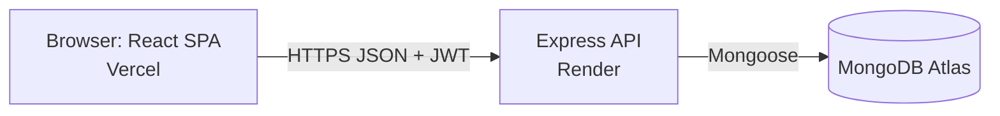
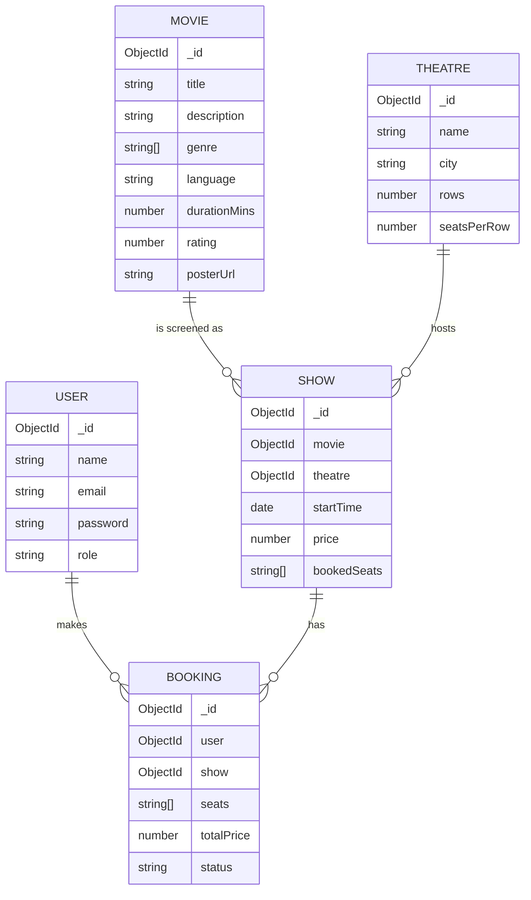
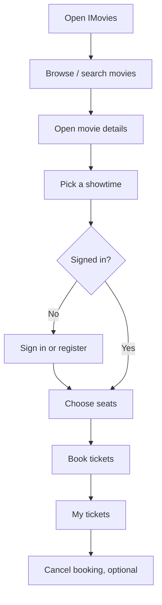

# Project architecture

## Technical architecture

- **Client** (`/client`): React single-page app. Talks to the API with `fetch`; keeps the JWT in `localStorage`.
- **Server** (`/server`): Express REST API, JWT auth middleware, role check for admin routes.
- **Database**: MongoDB with five collections (below).

## ER diagram

## MVC pattern (server)
| Layer | Folder | Role |
|---|---|---|
| Model | `server/src/models` | Mongoose schemas: User, Movie, Theatre, Show, Booking |
| View | `client/` | React UI renders the JSON the API returns |
| Controller | `server/src/controllers` | Business logic for each resource |
| Routes | `server/src/routes` | Maps URLs and HTTP verbs to controllers, with auth middleware |

## Roles and responsibilities
| Role | Can do |
|---|---|
| Guest | Browse movies, search, view showtimes, register, sign in |
| User | Everything a guest can, plus book seats, view own tickets, cancel own bookings |
| Admin | Everything a user can, plus add/delete movies, theatres and shows; see all bookings |

## Features
1. Movie catalogue with search and genre filter
2. Movie details and showtimes by day
3. Live seat map with taken-seat locking
4. Atomic double-booking prevention (single database update checks and claims seats)
5. Account registration and sign in (JWT, hashed passwords)
6. Booking history and cancellation with seat release
7. Admin dashboard for movies, theatres, shows and all bookings
8. Responsive layout, keyboard-accessible seat selection

## User flow

Admin flow: Sign in as admin → Admin page → add theatre → add movie → schedule show → monitor bookings.

## Execution steps
1. `npm run install:all`
2. Configure `server/.env` and `client/.env` from the `.env.example` files
3. `npm run seed` then `npm run dev:server` and `npm run dev:client`
4. Open `http://localhost:5173`

Save your output screenshots into `docs/screenshots/` (home, movie details, seat map, my tickets, admin) and link your demo video in the main README.
